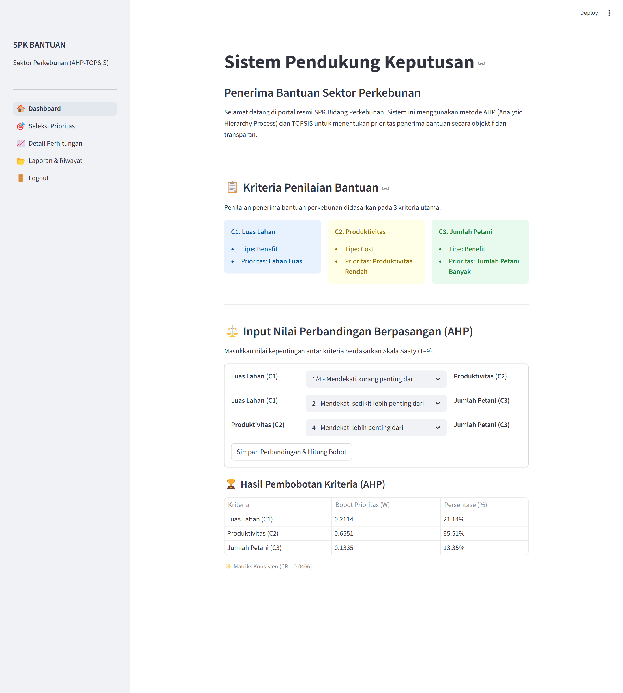

# 🌱 Sistem Pendukung Keputusan Penerima Bantuan Sektor Perkebunan (AHP–TOPSIS)


Aplikasi web **Sistem Pendukung Keputusan (SPK)** berbasis **Python** dan **Streamlit** yang mengintegrasikan metode **AHP (*Analytic Hierarchy Process*)** dan **TOPSIS (*Technique for Order of Preference by Similarity to Ideal Solution*)** untuk menentukan prioritas kelompok tani penerima bantuan sektor perkebunan secara terstruktur, objektif, dan transparan.

---

## 📌 Tentang Project

### Latar Belakang
Penentuan kelompok tani yang berhak menerima bantuan pada sektor perkebunan membutuhkan penilaian terhadap beberapa kriteria yang saling memengaruhi, baik kriteria bertipe *benefit* maupun *cost*. Proses seleksi yang dilakukan secara manual atau tanpa pembobotan yang teruji konsistensinya berisiko menimbulkan subjektivitas serta menyulitkan penelusuran dasar pengambilan keputusan.

### Permasalahan yang Diselesaikan
- **Subjektivitas bobot kriteria:** Tidak adanya mekanisme pembobotan terstruktur dan uji konsistensi antar kriteria penilaian.
- **Pengolahan data massal dan manual:** Kebutuhan untuk mengelola data kelompok tani sekaligus melakukan perhitungan perangkingan banyak alternatif secara cepat.
- **Transparansi & dokumentasi hasil:** Perlunya rincian langkah perhitungan matematis serta penyimpanan riwayat hasil seleksi yang dapat diekspor sebagai laporan.

### Tujuan dan Manfaat
Project ini dibangun untuk menyediakan sistem seleksi prioritas berbasis web dengan menggabungkan dua metode MCDM (*Multi-Criteria Decision Making*):
1. **AHP** digunakan untuk menentukan bobot prioritas setiap kriteria melalui matriks perbandingan berpasangan skala Saaty sekaligus memvalidasi konsistensi penilaian menggunakan *Consistency Ratio* ($CR < 0.1$).
2. **TOPSIS** digunakan untuk menghitung nilai preferensi ($V$) dan menyusun peringkat alternatif kelompok tani berdasarkan kedekatan jarak Euclidean terhadap solusi ideal positif ($A^+$) dan solusi ideal negatif ($A^-$).

Kriteria penilaian yang diimplementasikan pada sistem:
| Kode | Kriteria | Satuan | Tipe Kriteria | Arah Prioritas |
| :--- | :--- | :--- | :--- | :--- |
| **C1** | Luas Lahan | Ha | *Benefit* | Semakin luas semakin diprioritaskan |
| **C2** | Produktivitas | Kw/Ha | *Cost* | Semakin rendah semakin diprioritaskan |
| **C3** | Jumlah Petani | Orang | *Benefit* | Semakin banyak anggota semakin diprioritaskan |

---

## ✨ Fitur Utama

1. **Autentikasi Admin**
   - Halaman login untuk membatasi akses sistem menggunakan verifikasi `username` dan `password` yang di-hash dengan algoritma **SHA-256** serta persistensi sesi pada Streamlit.

2. **Dashboard & Pembobotan Kriteria (AHP)**
   - Menampilkan ringkasan informasi kriteria penilaian (C1, C2, C3).
   - Formulir input perbandingan berpasangan antar kriteria berdasarkan **Skala Saaty (1–9 dan nilai resiprokalnya 1/9–1/2)**.
   - Menghitung otomatis bobot prioritas ($W$), persentase bobot, serta status konsistensi matriks ($CR < 0.1$) dan menyimpannya ke database.

3. **Manajemen Data Alternatif & Seleksi Prioritas**
   - **Impor Massal via Excel (`.xlsx` / `.xls`):** Mendeteksi baris header dan memetakan kolom secara otomatis (`nama_kelompok`, `desa_kelurahan`, `luas_lahan`, `produktivitas`, `jumlah_petani`), dilengkapi opsi mengganti atau menonaktifkan data lama.
   - **Pengelolaan Data Manual (CRUD) & Pencarian:** Tambah, ubah, hapus, serta cari data kelompok tani aktif secara langsung melalui antarmuka web.
   - **Perhitungan & Visualisasi Ranking TOPSIS:** Menjalankan perhitungan TOPSIS menggunakan bobot AHP yang konsisten, menampilkan rekomendasi utama, tabel peringkat, grafik batang horizontal (hingga Top 30 alternatif) menggunakan Matplotlib, dan menyimpan hasil ke riwayat sesi.

4. **Detail Perhitungan Matematis (Step-by-Step)**
   - Menampilkan transparansi perhitungan secara bertahap untuk keperluan audit maupun dokumentasi:
     - **Tahapan AHP:** Matriks perbandingan berpasangan, jumlah kolom, matriks normalisasi, bobot prioritas ($W$), vektor konsistensi ($A \times W$ dan $CV$), $\lambda_{\max}$, *Consistency Index* ($CI$), dan *Consistency Ratio* ($CR$).
     - **Tahapan TOPSIS:** Matriks keputusan ($X$), matriks ternormalisasi ($R$), matriks ternormalisasi terbobot ($Y$), solusi ideal positif ($A^+$) dan negatif ($A^-$), jarak ideal ($D^+$ dan $D^-$), nilai preferensi ($V$), hingga ranking akhir.

5. **Laporan & Riwayat Sesi**
   - Menyimpan berbagai sesi perhitungan dengan nama sesi khusus.
   - Menampilkan kembali tabel peringkat, bobot AHP, dan detail tahapan TOPSIS dari sesi yang tersimpan, menghapus sesi, serta mengunduh laporan hasil perangkingan dalam format **Excel (`.xlsx`)**.

6. **Dokumen Referensi Perhitungan Manual (`report_manual_perhitungan.html`)**
   - Halaman HTML statis dengan rendering rumus matematika berbasis MathJax yang menjelaskan rumus dan contoh perhitungan manual AHP–TOPSIS serta mendukung pencetakan ke PDF melalui browser.

> **Catatan Implementasi:** Pada kode sumber `app.py` dan `utils.py` juga terdapat modul **Evaluasi Akurasi** (`evaluasi_akurasi_page` beserta visualisasi *Confusion Matrix* dan editor `status_aktual`), yang saat ini dinonaktifkan sementara dari menu navigasi sidebar.

---

## 🛠️ Teknologi dan Tools

| Teknologi / Library | Fungsi dalam Project |
| :--- | :--- |
| **Python** | Bahasa pemrograman utama untuk logika bisnis, perhitungan matematis, dan antarmuka aplikasi. |
| **Streamlit** | Framework web interaktif untuk membangun halaman login, navigasi multipage, form input, tabel, dan komponen UI. |
| **NumPy** | Pengolahan operasi matriks dan vektor numerik pada algoritma AHP dan TOPSIS. |
| **Pandas** | Manipulasi data tabular, pembacaan file Excel, pemformatan DataFrame hasil perhitungan, dan ekspor data. |
| **Matplotlib** | Pembuatan visualisasi grafik batang horizontal ranking prioritas penerima bantuan (serta chart *confusion matrix* pada utilitas). |
| **OpenPyXL** | *Engine* untuk membaca dan menulis file Excel (`.xlsx`) pada fitur impor data alternatif dan ekspor laporan hasil. |
| **SQLite (`sqlite3`)** | Database relasional lokal untuk menyimpan akun admin, data kelompok tani, konfigurasi AHP, sesi hitung, dan hasil perangkingan. |
| **HTML, CSS & MathJax** | Penyusunan dokumen referensi perhitungan manual SPK yang dapat dicetak ke PDF. |

---

## 📁 Struktur Folder

```text
ahptopsis/
├── app.py                          # Entry point aplikasi Streamlit & seluruh tampilan halaman
├── ahp.py                          # Modul perhitungan AHP (bobot prioritas & uji konsistensi)
├── topsis.py                       # Modul perhitungan TOPSIS (normalisasi, solusi ideal, jarak & ranking)
├── database.py                     # Inisialisasi skema SQLite, seeding awal, dan operasi CRUD/riwayat
├── auth.py                         # Autentikasi admin (hashing SHA-256 & manajemen session state)
├── utils.py                        # Utilitas grafik Matplotlib serta ekspor/template Excel & CSV
├── report_manual_perhitungan.html  # Dokumen statis penjelasan rumus & contoh hitung manual (cetak PDF)
├── requirements.txt                # Daftar dependency Python yang dibutuhkan
├── .gitignore                      # Daftar file/folder yang dikecualikan dari repository Git
├── README.md                       # Dokumentasi utama project
└── screenshots/                    # Direktori untuk menyimpan tangkapan layar tampilan aplikasi
    └── .gitkeep
```

> **Catatan:** File database lokal `db_bantuan.db` akan dibuat secara otomatis oleh fungsi `init_db()` di `database.py` saat aplikasi pertama kali dijalankan, dan dikecualikan dari Git melalui `.gitignore`.

---

## 💻 Persyaratan Sistem

Sebelum menjalankan aplikasi, pastikan perangkat Anda telah memenuhi kebutuhan berikut:
- **Sistem Operasi:** Windows, macOS, atau Linux.
- **Python:** Versi **3.10 atau lebih baru** (project diuji menggunakan Python 3.13).
- **Package Manager:** `pip` (sudah termasuk dalam instalasi Python standar).
- **Web Browser:** Chrome, Edge, Firefox, atau browser modern lainnya.
- **Koneksi Internet:** Diperlukan saat menginstal library dari PyPI (serta saat memuat CDN MathJax apabila membuka `report_manual_perhitungan.html`).

---

## 🚀 Cara Instalasi dan Menjalankan Project

1. **Clone repository ini**
   ```bash
   git clone https://github.com/2608Dinaria/Sistem-Pendukung-Keputusan_AHP-TOPSIS.git
   cd Sistem-Pendukung-Keputusan_AHP-TOPSIS
   ```

2. **Buat dan aktifkan *virtual environment* (disarankan)**

   - **Windows (PowerShell):**
     ```powershell
     python -m venv venv
     .\venv\Scripts\Activate.ps1
     ```
   - **macOS / Linux:**
     ```bash
     python3 -m venv venv
     source venv/bin/activate
     ```

3. **Instal seluruh *dependency***
   ```bash
   pip install -r requirements.txt
   ```

4. **Jalankan aplikasi Streamlit**
   ```bash
   streamlit run app.py
   ```

5. **Akses aplikasi di browser**
   - Setelah perintah dijalankan, Streamlit akan membuka aplikasi secara otomatis atau dapat diakses melalui `http://localhost:8501`.
   - Pada saat pertama kali dijalankan, `database.py` otomatis membuat file `db_bantuan.db` beserta tabel yang diperlukan, **10 data dummy kelompok tani awal**, dan akun admin default:
     - **Username:** `admin`
     - **Password:** `admin123`

   > **Catatan Keamanan:** Jika aplikasi akan digunakan pada lingkungan produksi atau diakses secara publik, ubah kredensial default pada tabel `tb_admin` terlebih dahulu.

---

## 📖 Panduan Penggunaan

Berikut alur penggunaan aplikasi dari awal hingga akhir:

1. **Login ke Sistem**
   - Buka aplikasi pada browser, masukkan **Username** dan **Password** admin, lalu klik **Login**.

2. **Atur Perbandingan Kriteria (Menu `Dashboard`)**
   - Tinjau keterangan 3 kriteria penilaian (C1, C2, C3).
   - Pada bagian **Input Nilai Perbandingan Berpasangan (AHP)**, pilih tingkat kepentingan untuk pasangan `C1 vs C2`, `C1 vs C3`, dan `C2 vs C3` menggunakan Skala Saaty.
   - Klik **Simpan Perbandingan & Hitung Bobot** untuk melihat bobot prioritas ($W$) dan memastikan matriks berstatus **Konsisten ($CR < 0.1$)**.

3. **Kelola Data & Jalankan Seleksi (Menu `Seleksi Prioritas`)**
   - **Opsi A — Upload Excel:** Unggah file `.xlsx` atau `.xls` yang berisi kolom data kelompok tani, tentukan apakah data lama ingin dikosongkan, lalu klik **Upload**. Format kolom yang dikenali sistem:
     | Kolom | Keterangan | Contoh |
     | :--- | :--- | :--- |
     | `nama_kelompok` | Nama kelompok tani *(wajib)* | Kelompok Tani Tunas Harapan |
     | `desa_kelurahan` | Nama desa/kelurahan *(opsional, default: Tidak Diketahui)* | Desa Makmur |
     | `luas_lahan` | Luas lahan dalam satuan Ha *(wajib, numerik)* | `5.50` |
     | `produktivitas` | Produktivitas dalam Kw/Ha *(wajib, numerik)* | `2.25` |
     | `jumlah_petani` | Jumlah anggota petani *(wajib, bilangan bulat)* | `25` |
   - **Opsi B — Kelola Manual:** Gunakan expander **Kelola Alternatif Secara Manual** untuk menambah, mengedit, atau menghapus data kelompok tani satu per satu.
   - Setelah data siap dan bobot AHP konsisten, klik tombol **Mulai Perhitungan SPK**.
   - Sistem akan menampilkan rekomendasi utama, tabel peringkat berdasarkan nilai preferensi ($V$), serta grafik batang prioritas.
   - Masukkan **Nama Sesi** lalu klik **Simpan ke Riwayat** untuk menyimpan hasil perhitungan ke database.

4. **Periksa Rincian Matematis (Menu `Detail Perhitungan`)**
   - Buka menu ini untuk meninjau setiap langkah perhitungan matriks AHP dan TOPSIS secara lengkap (mulai dari matriks berpasangan, normalisasi, uji konsistensi, hingga $A^+$, $A^-$, $D^+$, $D^-$, dan $V$).

5. **Lihat Riwayat & Unduh Laporan (Menu `Laporan & Riwayat`)**
   - Pilih sesi perhitungan yang pernah disimpan dari dropdown **Pilih Sesi**.
   - Klik tombol **Excel** untuk mengunduh laporan hasil perangkingan dalam format `.xlsx`, atau buka expander detail untuk memeriksa kembali tahapan TOPSIS sesi tersebut.

6. **Keluar dari Sistem (Menu `Logout`)**
   - Klik menu **Logout** pada sidebar untuk mengakhiri sesi admin.

---

## 🖼️ Tampilan Aplikasi

Dokumentasi tangkapan layar (*screenshot*) antarmuka aplikasi disimpan pada folder [`screenshots/`](./screenshots). Berikut daftar halaman dan fitur utama yang direkomendasikan untuk ditampilkan:

| No | Halaman / Fitur | Deskripsi Tampilan | Rekomendasi Nama File |
| :---: | :--- | :--- | :--- |
| 1 | **Halaman Login** | Form autentikasi admin sebelum masuk ke sistem | `screenshots/01-login.png` |
| 2 | **Dashboard & Pembobotan AHP** | Ringkasan kriteria, input Skala Saaty, dan tabel bobot prioritas serta nilai CR | `screenshots/02-dashboard-ahp.png` |
| 3 | **Seleksi Prioritas & Grafik** | Upload Excel, tabel data alternatif, hasil perangkingan TOPSIS, dan grafik batang | `screenshots/03-seleksi-prioritas.png` |
| 4 | **Detail Perhitungan** | Rincian matriks dan langkah matematis AHP dan TOPSIS | `screenshots/04-detail-perhitungan.png` |
| 5 | **Laporan & Riwayat** | Pilihan sesi riwayat tersimpan, tombol ekspor Excel, dan tabel hasil | `screenshots/05-laporan-riwayat.png` |

> Setelah file screenshot ditambahkan ke folder `screenshots/`, gambar dapat langsung disematkan di bagian ini menggunakan sintaks Markdown, misalnya:
> ```markdown
> 
> ```

---

## 👩‍💻 Pengembang

- **Nama:** Dinaria Simatupang
